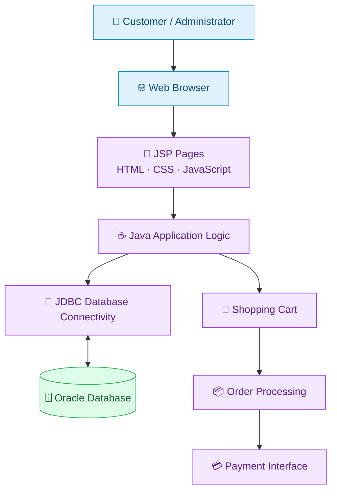

# 🛍️ AK Shop — Online Shopping Web Application

**AK Shop** is a Java-based e-commerce web application designed to help local retail businesses establish an online presence. It provides customers with a convenient platform to browse products, manage shopping carts, place orders, and explore available payment options.

The application uses **JSP, Java, JDBC, and Oracle Database** to support dynamic web pages and database-driven shopping workflows.

---

## 🌟 Key Features

- 🔐 **User Authentication** — Login and registration functionality for customers and administrators.
- 🗂️ **Category Browsing** — Explore products organized into different categories.
- 🛍️ **Product Browsing** — View available products and their details.
- 🛒 **Shopping Cart Management** — Add, view, and remove items from the shopping cart.
- 📦 **Checkout and Order Placement** — Enter delivery information and proceed through the order workflow.
- 💳 **Payment Options** — Payment interface with supported payment methods.
- 🛡️ **Admin Panel** — Manage supported categories, customer information, and store operations.
- 🧾 **Order Management** — View order information and order confirmation details.
- 🗄️ **Oracle Database Integration** — Store and retrieve application data using JDBC.

---

## 🏗️ System Architecture

AK Shop uses JSP pages for the presentation layer, Java and JDBC for application and database operations, Apache Tomcat as the web server, and Oracle Database for persistent storage.



### 🔄 Application Workflow

1. The customer opens AK Shop in a web browser.
2. JSP pages display products, categories, and shopping options.
3. The customer browses products and manages the shopping cart.
4. During checkout, the customer provides the required order and delivery details.
5. Java application logic uses JDBC to communicate with Oracle Database.
6. The application processes the supported order workflow and displays the relevant confirmation or order details.

---

## 🛠️ Technology Stack

| Technology | Purpose |
|---|---|
| Java | Application logic |
| JSP (JavaServer Pages) | Dynamic web pages |
| JDBC | Database connectivity |
| Oracle Database / Oracle XE | Persistent data storage |
| HTML5 | Web page structure |
| CSS3 | Styling and layout |
| JavaScript | Client-side interactions |
| Apache Tomcat | Web application server |
| Eclipse IDE | Development environment |
| Git and GitHub | Version control |

---

## 📋 Prerequisites

Before running the project, install and configure:

- Java Development Kit (JDK)
- Eclipse IDE with Java web development support
- Apache Tomcat Server
- Oracle Database or Oracle XE
- Compatible Oracle JDBC driver

---

## 🚀 Installation and Setup

### 1. Clone the Repository

Replace `YOUR-USERNAME` with your GitHub username.

```bash
git clone https://github.com/YOUR-USERNAME/ak-shop-ecommerce.git
```

### 2. Import into Eclipse

1. Open Eclipse IDE.
2. Import the project into your workspace.
3. Configure the required JDK.
4. Configure Apache Tomcat.
5. Add the Oracle JDBC driver to the project if it is not already configured.

### 3. Configure Oracle Database

1. Start the Oracle Database service.
2. Configure the database user and connection details.
3. Create the required database tables using the project's SQL scripts, if provided.
4. Update the JDBC connection URL, username, and password in the application's database configuration.

**Security note:** Never commit actual database passwords or other secrets to a public GitHub repository.

### 4. Run the Application

1. Right-click the project in Eclipse.
2. Select **Run As → Run on Server**.
3. Choose the configured Apache Tomcat server.
4. Start the application and open its deployed URL in your browser.

---

## 📁 Project Structure

The following is an illustrative structure. Actual folders and filenames may differ depending on the project configuration.

```text
ak-shop-ecommerce/
├── src/
│   └── Java source files
├── WebContent/
│   ├── home.jsp
│   ├── customers.jsp
│   ├── payments.jsp
│   ├── css/
│   ├── js/
│   └── images/
├── database/
│   └── SQL scripts
└── README.md
```

---

## 🔐 Security Considerations

- Use parameterized SQL queries to help prevent SQL injection.
- Validate user inputs on the server side.
- Protect administrator and customer pages with appropriate session checks.
- Store passwords securely using an appropriate password-hashing algorithm.
- Keep database credentials outside public source code.
- Use a trusted payment gateway for real transactions.

These are recommended security practices; verify which ones are implemented before describing the application as production-ready.

---

## 🔮 Future Enhancements

- Secure payment gateway integration.
- Product search, sorting, and filtering.
- Inventory and stock management.
- Order cancellation and tracking.
- Enhanced authentication and authorization.
- Improved mobile responsiveness.
- Deployment to a cloud hosting platform.

---

## 👨‍💻 Author

**Ayush Kumar**

Computer Science Engineering Graduate | Java Backend Development

GitHub: [YOUR-GITHUB-USERNAME](https://github.com/YOUR-GITHUB-USERNAME)

---

⭐ If you find this project useful, consider starring the repository.

*Developed as a learning and portfolio project in Java web application development.*
       +-------------------------------------------------------------+
       |                        Client Browser                       |
       |             (HTML5 / CSS3 / JavaScript / JSP UI)            |
       +------------------------------+------------------------------+
                                      |
                     HTTP Requests (Browse / Cart / Checkout)
                                      |
                                      v
       +-------------------------------------------------------------+
       |                  Apache Tomcat Web Server                   |
       +------------------------------+------------------------------+
                                      |
            +-------------------------+-------------------------+
            | (Handling Servlet Routing & Business Logic)       |
            v                                                   v
  +--------------------+                               +--------------------+
  | Sign/Verify Servlets|                              |  Controller Servlets|
  +---------+----------+                               +---------+----------+
            |                                                    |
            +-------------------------+-------------------------+
                                      |
                                      v
       +-------------------------------------------------------------+
       |                        Oracle Database                      |
       |         (OLNS_PROD_CATEGORIES, PRODUCTS, ORDERS, etc.)      |
       +-------------------------------------------------------------+
